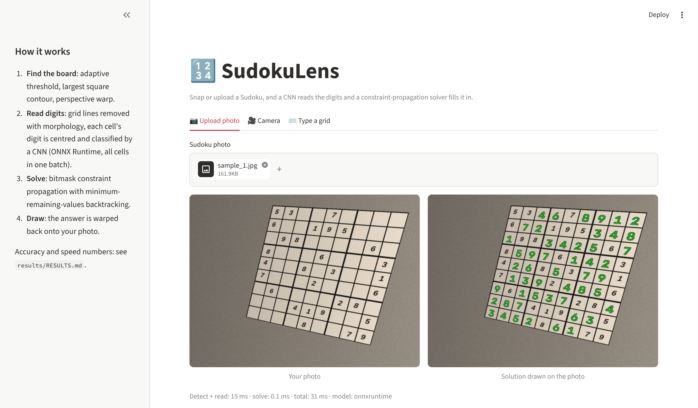
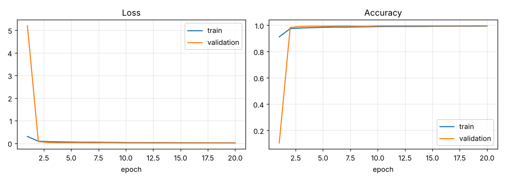

# SudokuLens: Sudoku Solver from a Photo

Take a photo of a Sudoku (printed or handwritten) and SudokuLens finds the grid, reads the digits with a CNN, solves the puzzle and draws the answer back onto the photo. It runs as a **web app** (upload or camera), a **live webcam** overlay, or a **command-line** tool.



## Results at a glance

All numbers come from `evaluation/evaluate.py` and are saved in [`results/metrics.json`](results/metrics.json) and [`results/RESULTS.md`](results/RESULTS.md). "Original" is the first version of this project (the notebooks in `notebooks/`), run on the same inputs.

| | Original | SudokuLens v2 |
|---|---:|---:|
| Digit accuracy, held-out real photos (Chars74K) | 40.8% | **99.0%** |
| Digit accuracy, unseen handwriting (MNIST test) | 87.7% | **99.4%** |
| Puzzles solved correctly from a photo (200 test photos) | 16.5% | **96.0%** |
| Board detected in photo | 91.0% | **100%** |
| Time per photo (detect, read, solve) | 75 ms | **12 ms** |
| Solving hard puzzles (6 well-known ones, mean) | 3.5 s | **4.0 ms** (~860x) |
| Worst case: 17-clue puzzle | 19.5 s | **0.6 ms** |
| Classifying a board's digits | 1,001 ms | **1.8 ms** |

The test photos are synthetic: puzzles rendered in font families held out from training, with random perspective, rotation, blur, noise, uneven lighting and JPEG compression, and 25% of boards containing handwritten MNIST *test* digits. Printed boards solved 100%, boards with handwriting 84%.

## Quick start

Requires Python 3.10 to 3.12.

```bash
python -m venv .venv
# Windows: .venv\Scripts\activate      macOS/Linux: source .venv/bin/activate
pip install -r requirements.txt

streamlit run app.py              # web app at http://localhost:8501
```

The app has three tabs:
- **Upload photo**: solves the image and shows the answer drawn on it. The recognised digits appear in an editable grid, so a misread digit can be fixed and re-solved. Low-confidence digits are flagged.
- **Camera**: take a picture in the browser.
- **Type a grid**: type or paste a puzzle (81 characters, `0` or `.` for blanks).

Sample photos to try are in `assets/`.

**Command line**
```bash
python -m sudokulens assets/sample_1.jpg -o solved.jpg
python -m sudokulens --grid "53..7....6..195....98....6.8...6...34..8.3..17...2...6.6....28....419..5....8..79"
```

**Live webcam** (needs the GUI build of OpenCV)
```bash
pip uninstall -y opencv-python-headless && pip install opencv-python
python realtime.py                # press q to quit
```

## How it works

```
photo ─► find board ─► warp to 450×450 ─► remove grid lines ─► 81 cells ─► CNN (one batch) ─► solver ─► draw answer back
```

1. **Board detection** (`sudokulens/vision.py`): grayscale, blur, adaptive threshold at a few strengths, then the largest convex quadrilateral whose angles are near 90° and sides near equal. Corners are refined to sub-pixel accuracy and the board is warped to a square.
2. **Digit extraction**: long horizontal and vertical strokes (grid lines) are removed with morphological opening. In each cell, the connected component near the centre that does not span the cell is the digit. It is scaled to 20×20 and centred by centre of mass in a 28×28 image (MNIST style). Training uses this exact function, so the model sees the same input it gets in production.
3. **Recognition** (`sudokulens/recognizer.py`): a CNN (4 conv layers with batch norm, about 469k parameters) exported to ONNX. All digits on a board are classified in one call with ONNX Runtime, so the app does not need TensorFlow.
4. **Solving** (`sudokulens/solver.py`): 9-bit candidate masks for every row, column and box; naked and hidden singles are filled before branching; branching always picks the cell with the fewest candidates. It detects conflicting givens and unsolvable puzzles, and can count solutions.
5. **Overlay**: missing digits are drawn on the flat board and warped back with the inverse perspective transform.

## What changed from the original

| Area | Original notebooks | Now |
|---|---|---|
| Interface | Jupyter notebook + Windows-only webcam loop | Streamlit app, CLI, cross-platform webcam script |
| Digit model | 2 conv layers, 390 training images, raw grayscale input | 4 conv layers + batch norm, about 71k training samples (Chars74K, synthetic board cells from 87 fonts, MNIST), augmentation, same preprocessing as inference |
| Inference | `model.predict` called once per cell (81 calls) | One batched ONNX Runtime call |
| Board detection | Largest contour only, fails on textured or noisy backgrounds | Multi-threshold search, convexity and shape checks, sub-pixel corners |
| Cell cleanup | Trims border rows that are 60% dark | Morphological grid-line removal plus component filtering |
| Solver | Rescans the whole board with Python lists at every step | Bitmasks, constraint propagation, MRV |
| Errors | Silently shows nothing | Clear messages, conflicting cells listed, editable grid |
| Code | Notebooks importing notebooks | Python package, tests, reproducible training and evaluation |

Note: the original `digitRecognition.h5` scores 40.8% on the held-out split here, although its notebook logged 84.7% on its own random split. The weights in the file evidently do not match that logged run. It is kept unchanged in `legacy/` for the comparison.

## Reproducing

```bash
pip install -r requirements-dev.txt
python training/train_digits.py        # about 15 min on CPU, writes models/ and results/training_*
python evaluation/evaluate.py          # writes results/metrics.json, RESULTS.md, confusion_matrix.png
pytest                                 # 14 tests
```

Training data: the original 488 Chars74K digit crops in `data/DigitImages` (fixed-seed 80/20 split; the 20% is only used for testing), cells cut from 1,500 synthetic board photos rendered with system fonts (every fifth font family is held out for testing), and 22,500 MNIST training digits (downloaded automatically by Keras).



## Project structure

```
app.py                  Streamlit web app
realtime.py             live webcam solver
sudokulens/             the package: vision.py, recognizer.py, solver.py, pipeline.py, synthetic.py, __main__.py (CLI)
models/                 digit_cnn.onnx (used by the app), digit_cnn.keras
training/               train_digits.py
evaluation/             evaluate.py, make_samples.py, ports of the original pipeline and solver for comparison
results/                metrics.json, RESULTS.md, training_history.json, confusion_matrix.png, training_curves.png
tests/                  pytest suite
data/DigitImages/       Chars74K digit crops (from the original project)
legacy/                 original digitRecognition.h5
notebooks/              original notebooks, unchanged
assets/                 sample photos and screenshots
```

## Limitations

- Test photos are synthetic. Real photos with strong glare, folds, or a board cut off at the edge of the frame can still fail. The editable grid in the app is the fallback.
- Handwritten digits are harder (84% of boards with handwriting are solved fully, and 99.4% of individual handwritten digits are read correctly).
- One board per photo. If there are several, the largest one is used.

## Tech stack

Python, OpenCV, TensorFlow/Keras (training), ONNX Runtime (inference), NumPy, Streamlit, pytest.

## Acknowledgements

Chars74K dataset (T. de Campos et al.), MNIST dataset (Y. LeCun et al.), OpenCV and Keras documentation.
