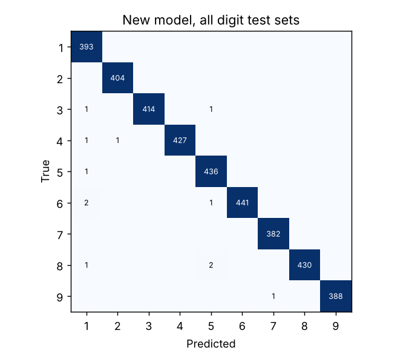

# SudokuLens evaluation results

Generated by `evaluation/evaluate.py` on 2026-11-18 (Linux-6.18.44-fc-v595-x86_64-with-glibc2.39, Python 3.12.3, CPU only).

## 1-2. Digit recognition accuracy

| Test set | Samples | Original model | New model |
|---|---:|---:|---:|
| Chars74K photos, held-out 20% split | 98 | 40.8% | **99.0%** |
| Printed digits, font families never seen in training | 1794 | 100.0% | **100.0%** |
| Handwritten digits (MNIST test split) | 1835 | 87.7% | **99.4%** |

## 3. End-to-end on synthetic photos

200 unseen photos (perspective, rotation, blur, noise, uneven light, JPEG; held-out fonts; 25% with handwritten digits).

| Metric | Original pipeline | New pipeline |
|---|---:|---:|
| Board detected | 91.0% | **100.0%** |
| Cell accuracy (81 cells, incl. blanks) | 87.00% | **99.95%** |
| Whole board read exactly | 16.0% | **96.0%** |
| Solved correctly | 16.5% | **96.0%** |
| Median time per photo | 75 ms | **12 ms** |

New pipeline solve rate: printed 100.0%, handwritten 84.0%.

## 4. Solver speed

| Puzzles | Original (ms) | New (ms) | Speed-up |
|---|---:|---:|---:|
| random (24-36 givens), n=200 | 4.14 | 0.33 | 13x |
| newspaper easy, n=1 | 1.90 | 0.08 | 23x |
| Arto Inkala 2012 ('world's hardest') | 589.6 | 11.54 | 51x |
| AI Escargot | 9.5 | 0.89 | 11x |
| Hard benchmark A (22 givens) | 195.4 | 0.69 | 284x |
| Easter Monster | 218.3 | 9.11 | 24x |
| Hard benchmark B (20 givens) | 206.4 | 1.16 | 178x |
| 17-clue puzzle (minimum possible givens) | 19503.3 | 0.59 | 32802x |

## 5. Inference speed

| Step | Time |
|---|---:|
| Load model, ONNX Runtime | 5 ms |
| Load model, Keras/TensorFlow | 91 ms |
| Classify 24 digits, original (one `predict` per cell) | 1001 ms |
| Classify 24 digits, Keras batched | 15.2 ms |
| Classify 24 digits, ONNX batched | **1.78 ms** |
| Full photo -> grid (detect + extract + classify) | 10 ms |
